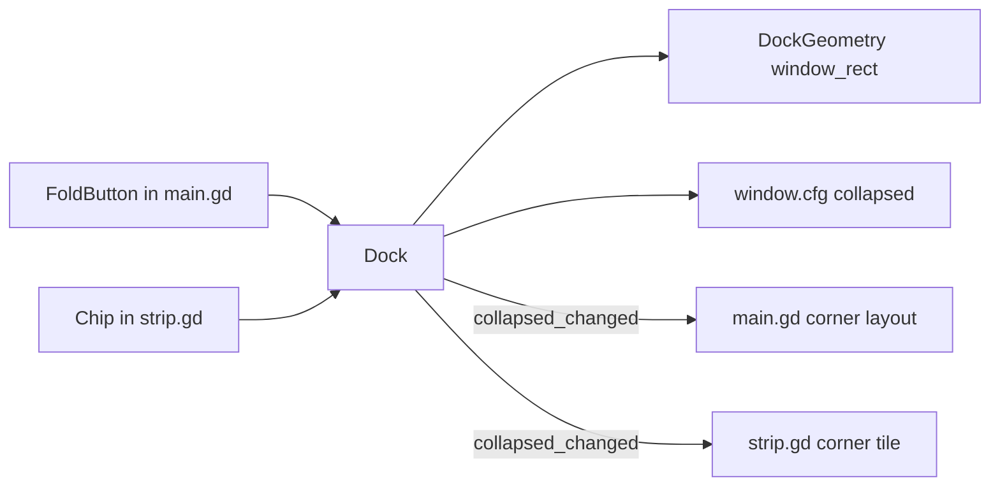

# Requirements

### Overview & Goals
Add a **collapsed** state to the strip. One click folds the full-width (or full-height) bar into a roughly square tile in the **bottom-right corner** of the usable screen rect. Another click unfolds it back. The corner tile **replaces the ticker preset**.

### Scope
**In scope**
- A fold/unfold toggle button on the bar and on the tile.
- A bottom-right corner tile. Its size follows the preset: compact 144×144, cozy 220×220, times the content scale.
- A corner popover for draft, service, recap, finished and settings. It grows out of the corner instead of spanning the screen.
- Stage reveal in the tile shows numbers only (stage, position, gap, clock) plus a thin progress bar.
- Removing the `ticker` preset, and migrating old `window.cfg` files.
- Docs (GDD §9 and §14, `AGENTS.md`, roadmap) and headless checks.

**Out of scope**
- Other corners, or a corner picker.
- A mini scrolling car scene in the tile.
- Free positioning of the tile. Dragging still only picks the screen.

### User Stories
- As a player, I want to fold the bar into a small corner tile so that it stops taking a whole screen edge while I work.
- As a player, I want the tile to tell me when a choice is waiting, and to open just enough room to make it, so that I don't have to unfold the whole bar.
- As a returning player who used the ticker, I want my setting carried over so that the strip still opens small.

### Functional Requirements
- **Toggle:** a fold button sits next to the settings gear.
  - On the expanded bar (bottom or left edge), pressing it collapses the strip into the tile.
  - On the tile, pressing it restores the bar on the saved edge and preset.
  - The state is saved in `window.cfg` as `collapsed` (bool) and restored on relaunch.
- **Tile geometry:** the tile is anchored to the bottom-right of the usable rect.
  - Its side is `preset_size(preset) × scale`, clamped to the usable rect.
  - The edge setting has no effect while collapsed; it is kept for unfolding.
- **Tile content:**
  - **Idle:** the emblem and a short "Start" button. On the very first launch, a short intro line.
  - **Stage reveal:** stage n/total, position, gap, stage clock, and a thin progress bar. No chip.
  - **Draft / service / recap / finished:** the phase title and the pulsing decision chip. Service also shows the clock.
- **Popover:**
  - Pressing the chip, or the gear, grows the window to 640×340 (times the scale, clamped), anchored bottom-right.
  - It shows the phase body (or the settings cluster) above a bottom row that holds the chip to close it.
  - It is transient and not saved.
  - The first draft ever auto-opens it once (the existing `seen_panel_hint`).
  - A phase change closes it.
- **Settings:** the Height group offers Compact and Cozy only. Edge stays Bottom/Left.
- **Migration:** a stored `preset = "ticker"` loads as `compact` with `collapsed = true`.
- **Hit area:** only the tile (or the popover) catches clicks. The rest of the corner passes through.

### Non-Functional Requirements
- No forever animation in the tile while idle. The chip pulse follows the existing pulse rules.
- The game never takes keyboard focus. Everything is mouse-operable.
- The overlay must be verified outside the embedded game view.

# Technical Design

### Current Implementation
- `scripts/dock/dock_geometry.gd`: `window_rect(usable, edge, preset, focus, scale)` has a left branch and a bottom branch. `PRESET_TICKER`, `SIZE_TICKER` (64) and `is_ticker()` define the slim bar.
- `scripts/dock/dock.gd`:
  - Holds `_preset`, `_edge`, `_focus`, `_panel_phase`, `_panel_open`, `_settings_open` and `_seen_panel_hint`.
  - `_sync_focus()` turns those into a transient focus rect.
  - `_place_on_screen`, `_snap_if_dock_drifted` and `_follow_drag_screen` all call `window_rect`.
  - `_load_config` and `_save_config` handle `window.cfg`.
  - The `edge_changed` signal triggers layout rebuilds.
- `scripts/boot/main.gd`:
  - `_apply_ticker_layout()`, `_apply_side_layout()` and the bottom layout place the handle, gear, settings panel and HUD.
  - The Height group is built from `%Compact`, `%Cozy` and `%Ticker` in `scenes/boot/main.tscn`.
- `scripts/hud/strip.gd`: `_rebuild_now()` branches on `Dock.is_ticker()` into `_build_ticker()`, `_build_ticker_row()` and `_fill_idle_ticker()`, with `_panel_chip()` and `_build_reveal()`.
- `sim/checks/ui_checks.gd`: asserts the ticker rects (rest `0,976,1920×64`, open `0,700,1920×340`) and checks that no ticker controls overflow or overlap.

### Key Decisions
- **Collapsed is a separate saved bool, not a preset.** The preset (compact/cozy) keeps driving the tile size, and unfolding restores the exact bar. Rationale: this matches answer 1 (toggle) and answer 4 (size follows compact/cozy).
- **The ticker's panel flow is reused as the popover.** `_panel_open`, `_panel_phase`, `_settings_open` and `seen_panel_hint` keep their meaning; `is_ticker()` is replaced by `is_collapsed()`. Rationale: the phase-driven logic is already tested, and only the rect and the layout change.
- **Bottom-right only, edge-independent.** While collapsed, the rect ignores `_edge`, so no corner key is stored.
- **The popover is 640×340.** It is wider than the 520 discussed earlier, so that three service cards and the draft columns still fit. The checks verify the fit.
- **Ticker removed.** An old `ticker` value is migrated in one static helper so the rule can be checked headlessly.

### Proposed Changes
- **DockGeometry**
  - Drop the ticker constants and `is_ticker`.
  - Add the `collapsed` parameter and a corner branch to `window_rect`.
  - Add `migrate_preset`.
- **Dock**
  - Add `_collapsed`, `is_collapsed()`, `set_collapsed()` and the signal `collapsed_changed`.
  - `set_collapsed()` resets `_panel_open`, then calls `_sync_focus`, `_reapply_placement`, `_save_config` and emits the signal.
  - `_sync_focus` uses `_collapsed` where it used `is_ticker()`.
  - Pass `_collapsed` to every `window_rect` call.
  - Load and save the `collapsed` key, and migrate `ticker`.
  - `set_preset` rejects `ticker`.
  - Update the header docstring.
- **main.tscn / main.gd**
  - Remove the `%Ticker` button. Add a `%FoldButton` next to `%SettingsButton`; its icon or text flips between fold and unfold.
  - Replace `_apply_ticker_layout` with `_apply_corner_layout(radius)`:
    - a thin top drag bar;
    - gear and fold buttons in the top-right of the tile, or in the bottom row while the popover is open;
    - the settings panel filling the popover above the bottom row;
    - the HUD filling the rest.
  - Connect `Dock.collapsed_changed` to relayout, as `edge_changed` already does.
- **strip.gd**
  - Rename `_build_ticker*` to `_build_corner`, `_build_corner_tile(phase)` and `_build_corner_row(phase)`:
    - **Closed:** a VBox tile with the idle lockup and Start button, the reveal numbers with the progress fill, or the title and chip.
    - **Open:** the phase body, then a row with the title, clock and chip.
  - Reveal in the tile reuses `_reveal_label`, `_clock_label` and `_progress_fill`, so `_update_dynamic_labels()` keeps updating them.
  - Connect `Dock.collapsed_changed` to `_queue_rebuild`.
- **Docs:** GDD §9.1 (corner tile, popover, toggle), §9.2 (tile content per phase), §9.3 (Height without ticker, fold button) and the §14 `window.cfg` row. Also the `AGENTS.md` window.cfg bullet and a phase 7 roadmap entry.

### Data Models / Contracts
```gdscript

# DockGeometry

const SIZE_POPOVER := Vector2i(640, 340)
static func window_rect(usable: Rect2i, edge: String, preset: String, focus: bool, scale: float, collapsed := false) -> Rect2i

# collapsed: size = focus ? SIZE_POPOVER*scale : Vector2i.ONE*preset_size(preset)*scale (clamped)

# position = usable.end - size

static func migrate_preset(stored: String) -> Dictionary  # {"preset": String, "collapsed": bool}

# Dock

signal collapsed_changed
func is_collapsed() -> bool
func set_collapsed(collapsed: bool) -> void
```
`window.cfg` `[window]` gains `collapsed` (bool, default `false`). `preset` becomes `compact` or `cozy`.

### Architecture Diagram


### Risks
- **Draft and service bodies at 640 px wide** may overflow. The checks assert that the controls are enclosed, and the popover width is a single constant to tune.
- **Tile on a small screen or at 2× scale:** clamping to the usable rect keeps it on screen.
- **Stale `ticker` references:** a grep for `ticker`/`TICKER` should leave only migration code and comments.

# Testing

### Validation Approach
- Run `godot --headless --path . -s res://sim/checks/run_checks.gd`. This includes `ui_runner.tscn`.
- Run the overlay outside the embedded game view to confirm the corner placement and hit area by hand.

### Key Scenarios
- **Geometry checks** (usable `0,0,1920×1040`):
  - collapsed compact → `Rect2i(1776, 896, 144, 144)`;
  - collapsed cozy → `Rect2i(1700, 820, 220, 220)`;
  - collapsed with focus → `Rect2i(1280, 700, 640, 340)`;
  - compact at scale 1.5 → a 216 square;
  - the left edge while collapsed gives the same corner rect;
  - collapsed off still returns the existing bottom and left rects.
- `migrate_preset("ticker")` → compact + collapsed; `migrate_preset("cozy")` → cozy + not collapsed.
- **UI checks** (replacing the ticker ones):
  - a draft phase while collapsed does not auto-grow;
  - the first draft opens the popover once;
  - the chip toggles `DraftView`;
  - the gear borrows the popover, and closing settings returns to the tile;
  - the fold button switches between the bar and the tile.
- Within the tile and the popover viewport: Start, chip, gear, fold, Quit and the scale controls are enclosed and do not overlap.

### Edge Cases
- Collapsing while the popover is open closes it.
- A phase change while open closes it.
- Changing the preset while collapsed resizes the tile.
- Changing the edge while collapsed takes effect only after unfolding.
- The headless run never writes `window.cfg`.

# Delivery Steps

### ✓ Step 1: Update GDD, AGENTS.md and roadmap for the corner tile
The design docs describe the collapsed corner tile and replace the ticker.
- GDD §9.1: the fold toggle, the bottom-right tile sized by compact/cozy, the 640×340 transient popover and the saved `collapsed` key.
- GDD §9.2: tile content per phase (numbers-only reveal, chip for choice phases).
- GDD §9.3: Height offers Compact and Cozy only; add the fold button.
- GDD §14 `window.cfg` row and the `AGENTS.md` window.cfg bullet: add `collapsed`, drop `ticker`, note the migration.
- Add a phase 7 entry in `docs/plans/00-roadmap.md`.

### ✓ Step 2: Add collapsed geometry and state to DockGeometry and Dock
The window can be placed as a bottom-right tile or popover, and the state persists in window.cfg.
- `dock_geometry.gd`:
  - remove `PRESET_TICKER`, `SIZE_TICKER` and `is_ticker`;
  - add `SIZE_POPOVER` and the `collapsed` parameter with a corner branch in `window_rect`;
  - add `migrate_preset`.
- `dock.gd`:
  - add `_collapsed`, `is_collapsed()`, `set_collapsed()` and the signal `collapsed_changed`;
  - `_sync_focus` uses `_collapsed`;
  - pass `_collapsed` to `_place_on_screen` and `_snap_if_dock_drifted`;
  - load and save `collapsed` and migrate `ticker`;
  - reject `ticker` in `set_preset`;
  - update the docstring and the probe print.
- `sim/checks`: add geometry and migration checks (corner rects, popover rect, scaling, edge independence, unchanged bar rects).

### ✓ Step 3: Add fold button and corner layout to main scene chrome
The bar shows a fold button, and the tile and popover lay out the handle, gear, fold button and settings correctly.
- `scenes/boot/main.tscn`: remove `%Ticker`; add `%FoldButton` beside `%SettingsButton`.
- `main.gd`:
  - bind the fold button to `Dock.set_collapsed(not Dock.is_collapsed())`;
  - drop the ticker preset wiring from `_bind_chrome` and `_group_settings`.
- Replace `_apply_ticker_layout` with `_apply_corner_layout`:
  - a top drag bar;
  - the buttons in the tile's corner, or in the popover's bottom row;
  - the settings panel filling the popover.
- Relayout on `Dock.collapsed_changed`.
- Update the `ui_checks.gd` chrome checks: the fold toggle switches rects, and the gear and fold buttons are enclosed in the tile and the popover.

### ✓ Step 4: Build corner tile and popover content in the HUD strip
The tile shows idle, numbers-only reveal and choice chips, and the popover hosts the phase bodies.
- `strip.gd`: replace `_build_ticker`, `_build_ticker_row` and `_fill_idle_ticker` with `_build_corner`, `_build_corner_tile` and `_build_corner_row`.
- Closed tile:
  - idle: emblem plus Start (or the intro line on first launch);
  - reveal: stage, position, gap, clock and progress fill, reusing the dynamic labels;
  - choice phases: title plus the pulsing chip.
- Open popover: the phase body above a row with title, clock and chip.
- Rebuild on `Dock.collapsed_changed`.
- Port the ticker UI checks to the corner:
  - no auto-grow;
  - the first-draft hint;
  - the chip toggles `DraftView`;
  - settings borrow the popover;
  - draft and service controls fit in 640×340 without overlap.
- Grep that no `ticker` references remain outside the migration.