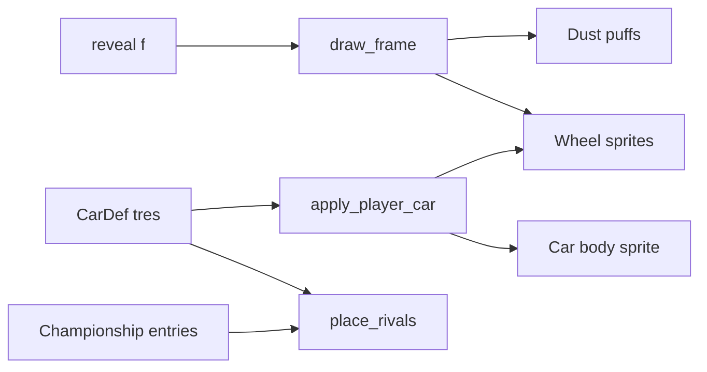

# Requirements

### Overview & Goals
The six cars (Comet, Dart, Mudbug, Sled, Teapot, Wagon) are currently 3–8 flat SVG shapes. They look like blobs on the reveal road, on the draft cards, and as the shared rival silhouette. The goal is to redraw them in an *art of rally*-inspired style while keeping GDD §10 rules: soft shapes, a limited palette, side view, and no forever-animating idle strip.

### Scope
**In scope**
- New stage sprites for all six cars (`scenes/stage/art/cars/*.svg`).
- Draft portraits rebuilt from the new side views (`scenes/draft/art/cars/*.svg`).
- One small rival silhouette per car, so each rival shows its own car model.
- Joke cars become believable rally cars:
  - Teapot becomes a round little hatch with a spout-like snorkel.
  - Sled becomes a rally body on skis.
- Wheels spin with reveal progress, and dust or spray trails behind the player car.

**Out of scope**
- Changes to the background layers, incident pose clips, solver, or save format.
- Shaders, particles that read `TIME`, and 3D.

### User Stories
- As a player, I want my drafted car to look like a real little rally car, so the reveal feels like a rally.
- As a player, I want to recognise rival cars by their shape, so the field reads at a glance.
- As a player, I want the car to look like it is driving (wheels turning, dust kicking up), so the strip feels alive while a stage plays.

### Functional Requirements
- **Art style.** Each car has a crisp, chunky silhouette with these features:
  - Flat faceted shading in three tones per livery (light roof plane, mid side, dark sill).
  - Dark glass with one highlight facet.
  - Wheel arches, mud flaps, a race-number roundel, and lights.
  - No outlines.
- **Car concepts:**
  - Comet: low wedge coupe in purple and gold, with a light pod.
  - Dart: boxy hot hatch in red and yellow.
  - Mudbug: lifted buggy in green, with big tyres and mud splatter.
  - Sled: teal rally body on front and rear skis.
  - Teapot: round copper hatch with a snorkel spout.
  - Wagon: blue estate with a roof rack and spare wheel.
- **Canvas.** Stage art stays 96x64. Wheel bottoms (or ski bottoms) sit on y = 55, so placement on the road does not change.
- **Wheel spin.** Wheels rotate from the reveal fraction `f`, so a paused championship or a frozen `f` shows still wheels. Sled has no wheels.
- **Dust.** A few puffs trail behind the rear wheel, tinted by surface:
  - Gravel: dusty yellow.
  - Tarmac: faint grey.
  - Snow: white spray.
  
  Puffs stay on the road during a hop (like the shadow) and freeze when `f` freezes.
- **Rivals.** Each rival marker uses its entry's car silhouette. A small tinted band (the existing `RIVAL_COLORS`) tells apart rivals that drive the same car.
- **Portraits.** Draft cards show the new car art (wheels baked in) on the existing card frame.

### Non-Functional Requirements
- No new autoload, no save field, no `TIME` shader. Motion only happens during `stage_reveal`, at its existing ~30 fps redraw cap.
- The art stays readable at the minimum car scale (0.4) and in the compact 144 px strip.

# Technical Design

### Current Implementation
- `scripts/stage/stage_view.gd` (`StageView`) works like this:
  - It puts `CarDef.stage_sprite` on the `%Car` `Sprite2D` under `Player/Pose`.
  - It adds a shadow `Sprite2D` under `Player`.
  - It builds 7 rival `Sprite2D`s that all use `car_rival.svg`, tinted with `RIVAL_COLORS`.
  - It places everything in `_draw_frame(f, …)`, which only runs when `f`, the size, or the stage changes.
- Art constants: `CAR_ART_SIZE = 96x64` and `CAR_GROUND_Y = 55`.
- `data/car_def.gd` exports `portrait` and `stage_sprite`. The `data/cars/*.tres` files point at `scenes/draft/art/cars/<id>.svg` and `scenes/stage/art/cars/<id>.svg`.
- Rivals are `Championship.entries`, and each has a `car_id` (`sim/entry.gd`). `_place_rivals` iterates ranked rows by `entry_id`.
- `sim/checks/ui_checks.gd` only asserts that `portrait` and `stage_sprite` are not null.

### Key Decisions
- **Wheels are separate sprites.** Stage bodies are drawn without wheels. One shared `wheel.svg` (tyre, rim, 5 spokes) is scaled per car. Rotating sprites is the only way to spin wheels without frame sheets.
- **Wheel layout is data on `CarDef`.** It holds wheel centres and a radius, which keeps design data in `.tres` as AGENTS.md requires.
- **Motion is a pure function of `f`.** Spin and dust come from static functions in `StageView`, not particles or timers. Pause, low-processor mode, and headless checks all work without extra code.
- **Each car has its own rival sprite.** Every car gets a 26x14 rival SVG. Downscaling the 96 px raster would blur it. A shared `rival_band.svg` child, tinted with `RIVAL_COLORS[index]`, separates duplicate cars (7 rivals share 4 cars).

### Data Models / Contracts
```gdscript

# data/car_def.gd (new exports, presentation only)

## Small side silhouette for rival markers, 26x14, livery colours baked in.
@export var rival_sprite: Texture2D
## Wheel hub centres in stage-art pixels (96x64). Empty for cars on skis.
@export var wheel_centers: PackedVector2Array = PackedVector2Array()
## Wheel radius in stage-art pixels; center.y + radius == StageView.CAR_GROUND_Y.
@export var wheel_radius: float = 7.0
```
```gdscript

# scripts/stage/stage_view.gd (new statics, checked headless)

const WHEEL_ART_RADIUS := 8.0      # wheel.svg is 16x16
const WHEEL_TURNS := 600.0         # turns over a whole stage; tuned by eye
const DUST_PUFFS := 4
const DUST_RATE := 900.0           # puff cycles per stage
const DUST_TINTS := {"gravel": Color(...), "tarmac": Color(...), "snow": Color(...)}
static func wheel_angle(f: float) -> float          # fposmod(f * WHEEL_TURNS * TAU, TAU)
static func dust_puff(f: float, index: int) -> Dictionary  # {offset: Vector2, scale: float, alpha: float}
```
`dust_puff` uses `phase = fposmod(f * DUST_RATE + index / DUST_PUFFS, 1.0)`:
- The offset drifts left (behind the car) and up.
- The scale grows.
- The alpha fades to 0 at phase 1.

### Proposed Changes
- **Stage art.** Redraw the six bodies without wheels. Add `wheel.svg` (Sled has skis baked into its body) and `dust_puff.svg` (soft round blob). Fill in `wheel_centers` and `wheel_radius` in each `.tres`.
- **`StageView` wheels:**
  - `_apply_player_car()` creates one `Sprite2D` per `wheel_center` as a child of `%Car`, centred, scaled `wheel_radius / WHEEL_ART_RADIUS`. The wheels then inherit car scale and pose rotation.
  - `_draw_frame` sets `rotation = wheel_angle(f)` on each wheel.
- **`StageView` dust.** `_ready` adds `DUST_PUFFS` sprites under `%Player` (road level, behind `Pose`, next to the shadow). `_draw_frame` places them from `dust_puff(f, i)` relative to the rear wheel × car scale. `_apply_surface` sets the tint, and puffs are hidden for `f >= 1`.
- **Rivals.** `_build_rivals` gives each marker a band child. `_place_rivals` looks up `champ.find_entry(entry_id).car_id`, then sets `marker.texture = CATALOG.car(car_id).rival_sprite`, falling back to the old silhouette art. The tint moves from the marker's `modulate` to the band. `RIVAL_SIZE` stays 26x14.
- **Portraits.** Rewrite `scenes/draft/art/cars/<id>.svg` as the existing cream card frame plus the new body with wheels inlined. The portrait size and frame stay the same.
- **Docs.** Add one line to GDD §10 on the car art direction (faceted rally liveries, spin and dust driven by `f`).

### File Structure
```
scenes/stage/art/
  wheel.svg            # new, 16x16
  dust_puff.svg        # new
  rival_band.svg       # new, tinted stripe over the rival silhouette
  car_rival.svg        # kept as the fallback silhouette
  cars/<id>.svg        # redrawn bodies (no wheels)
  cars/<id>_rival.svg  # new, 26x14, one per car
scenes/draft/art/cars/<id>.svg   # redrawn portraits
data/car_def.gd                  # new exports
data/cars/<id>.tres              # rival_sprite, wheel_centers, wheel_radius
scripts/stage/stage_view.gd      # wheels, dust, rival lookup
sim/checks/ui_checks.gd          # new checks
docs/GDD.md                      # §10 line
```
Godot writes the `.import` and `.uid` files for the new SVGs on import (`godot --headless --import`). They are committed.

### Architecture Diagram


### Risks
- **Wagon-wheel strobing.** Spokes have 5-fold symmetry, so keep the per-frame step under 36°. A check bounds it for a typical reveal. Tune `WHEEL_TURNS` down if wheels appear to spin backwards.
- **Detail lost at small scale.** Car scale can drop to 0.4. Keep the shapes chunky and avoid strokes under 2 px.
- **Windows passthrough.** Transparent pixels must stay inside the existing hit polygon. The art keeps the same 96x64 box, so this does not change.

# Testing

### Validation Approach
- Run the headless checks: `godot --headless --path . -s res://sim/checks/run_checks.gd`. This also runs `ui_runner.tscn`, which holds the extended `ui_checks.gd`.
- Run the reveal by hand outside the embedded game view, in compact and cozy, on gravel, tarmac, and snow stages.

### Key Scenarios
- Every car has `portrait`, `stage_sprite`, and `rival_sprite`.
- Stage sprites are 96x64 and rival sprites are 26x14.
- For each wheeled car, every `center.y + wheel_radius` is within 0.5 px of `CAR_GROUND_Y`. Sled has empty `wheel_centers`.
- `wheel_angle(0) == 0`. The value stays inside [0, TAU).
- The angle step for a ~30 fps redraw over a typical reveal stays under 36°.
- `dust_puff` always gives `offset.x <= 0` (behind the car) and alpha in [0, 1]. Alpha falls as the phase grows. The same `f` always gives the same result.
- In a StageView test, the player car gets one wheel node per `wheel_center`. Rival markers show the `rival_sprite` of their entry's `car_id`.

### Edge Cases
- Paused championship: wheels and dust do not change between frames.
- Car with no `rival_sprite`: falls back to `car_rival.svg`.
- Sled: no wheel nodes, and the snow spray still shows.
- Hop pose: dust stays at road level and the wheels rotate with the body.

# Delivery Steps

### ✓ Step 1: Redraw stage car bodies and add wheel data to CarDef
All six cars have faceted, rally-livery bodies on the road, with separate wheel art and wheel layout stored in their `.tres`.

- Add `rival_sprite`, `wheel_centers`, and `wheel_radius` exports to `data/car_def.gd`.
- Redraw `scenes/stage/art/cars/{comet,dart,mudbug,sled,teapot,wagon}.svg` at 96x64:
  - No wheels in the body art.
  - Three-tone flat shading, arches, mud flaps, number roundel.
  - Sled has skis baked in.
- Add `scenes/stage/art/wheel.svg` (16x16, tyre, rim, 5 spokes).
- Fill `wheel_centers` and `wheel_radius` in `data/cars/*.tres` so wheel bottoms sit on y = 55. Leave them empty for Sled.
- Run the headless import so `.import` and `.uid` files are generated.
- Extend `ui_checks.gd` with art size and wheel-ground-line checks.

### ✓ Step 2: Spinning wheels in StageView
The player car's wheels rotate from reveal progress and stay still when paused.

- `_apply_player_car()` builds one centred wheel `Sprite2D` per `wheel_center` under `%Car`, scaled by `wheel_radius / WHEEL_ART_RADIUS`.
- Add `WHEEL_ART_RADIUS`, `WHEEL_TURNS`, and `static func wheel_angle(f)` to `scripts/stage/stage_view.gd`.
- Set the wheel rotation in `_draw_frame`.
- Add checks for `wheel_angle` range, the zero start, the per-frame step bound, and the wheel node count for a drafted car.

### ✓ Step 3: Surface-tinted dust trail
Dust or spray puffs trail behind the rear wheel during the reveal, tinted by surface.

- Add `scenes/stage/art/dust_puff.svg`.
- Create `DUST_PUFFS` sprites under `%Player`, behind `Pose`, in `_ready`.
- Add `static func dust_puff(f, index)` and place puffs in `_draw_frame` relative to the rear wheel × car scale.
- Tint the puffs in `_apply_surface` from `DUST_TINTS` (gravel, tarmac, snow).
- Add checks that `dust_puff` gives a position behind the car, alpha in [0, 1] that falls over the phase, and the same result for the same `f`.

### ✓ Step 4: Per-car rival silhouettes
Each rival marker shows its own car's silhouette, with a tinted band to tell apart rivals in the same car.

- Draw `scenes/stage/art/cars/<id>_rival.svg` (26x14) for all six cars and set `rival_sprite` in each `.tres`.
- Add `scenes/stage/art/rival_band.svg`.
- `_build_rivals` adds a band child tinted with `RIVAL_COLORS[index]`. The marker itself is no longer tinted.
- `_place_rivals` sets the marker texture from the entry's `car_id`, falling back to `car_rival.svg`.
- Add checks that every car has a 26x14 `rival_sprite` and that markers use their entry's car.

### ! Step 5: Rebuild draft portraits and document the art direction
Draft cards show the new rally cars, and the GDD records the style.

- Rewrite `scenes/draft/art/cars/<id>.svg` as the existing card frame plus the new body with wheels inlined (same size).
- Add one line to `docs/GDD.md` §10 on faceted rally liveries and spin and dust driven by `f`.
- Run the full headless checks.
- Run a manual non-embedded reveal in compact and cozy on all three surfaces.