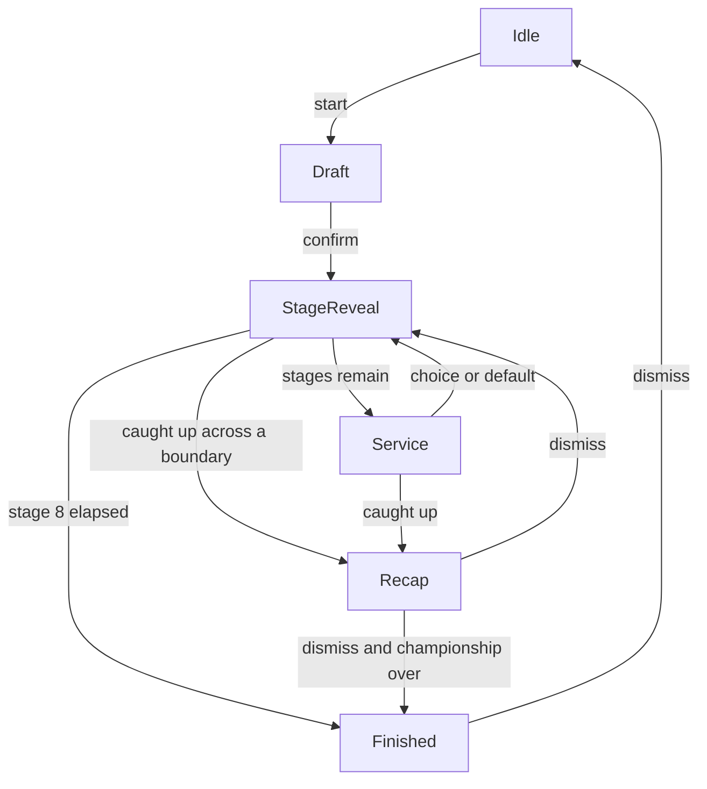

# Game Design Document: Idle Rally Manager

## 1. Executive summary

Idle Rally Manager is a cozy desktop companion. A small rally team of animals lives in a strip along the bottom of the screen while the player works. The player drafts a driver and a car, then watches an eight-stage championship resolve across a workday. Racing is hands-off. The meaningful choices happen before the championship and in the service park between stages.

| | |
| --- | --- |
| Genre | Desktop companion, cozy idle management |
| Platform | Windows, Linux, macOS. Steam later. The development machine is Linux. |
| Engine | Godot 4.7, GDScript |
| Visual style | 2D illustrated vector art. Cute animals. Flat and calm. |
| Form factor | A borderless strip docked to a screen edge. Bottom edge first. |
| Session | One championship is about eight hours of wall-clock time. |
| v1 scope | Solo championship against AI, local save, restart. |
| Later | Career unlocks, side dock, multiplayer by room code. |

The strip floats above other windows. It does not reserve a taskbar slot, so maximized apps can extend underneath it. Clicks outside the strip hit the app behind it. The game does not take keyboard focus.

## 2. Pillars and non-goals

Pillars:

- **Companion, not a destination.** The game is readable in a glance and ignorable for half an hour.
- **Sparse input.** A workday needs a draft at the start and one choice per service park. Nothing else is required to finish.
- **Fair while you are away.** Results are fixed when a stage starts. Closing the app, or missing a prompt, never rerolls a stage.
- **Cozy stakes.** Cars limp home. They do not explode, crash out, or punish the player with a lost save.
- **Quiet attention.** A waiting choice pulses inside the strip. The game does not open a modal over the desktop.

Non-goals for v1:

- Live driving, mid-stage pit stops, or any input that changes a stage already underway.
- A fullscreen transparent desktop pet. The window is only as large as the strip.
- Reserving screen space the way a system panel does (Wayland layer-shell, X11 struts, Windows AppBar).
- Career unlocks, daily login rewards, and real-money purchases.
- Realtime multiplayer and voice.
- Pixel art, 3D, or a physics-driven car.

## 3. Session model

A championship is a workday. Eight stages run back to back. Each stage block is one hour of wall-clock time:

- **30 minutes, stage reveal.** The result already exists. The strip plays it back.
- **30 minutes, service park.** The player may pick an upgrade. The park keeps idling if they do not.

Wall-clock constants live in one place (`sim/timing.gd`):

- `STAGE_REVEAL_SEC = 1800`
- `SERVICE_SEC = 1800`

A debug time scale multiplies elapsed championship time. Shipping builds keep the scale at `1`. Debug builds may set it from the strip so a full championship can be stepped in seconds. The scale changes how fast the clock advances. It does not change seeded results.

Pause freezes championship time and leaves the window where it is. Pause is available during a reveal and during service. The draft has no clock.

Closing the app saves immediately. On the next launch the scheduler catches up:

- If the current phase is still running, the reveal or the service timer seeks to "now".
- If one or more phase boundaries passed while the app was closed, each missed service applies the default card, each missed stage is recorded, and the strip opens on a short recap before showing the live phase.
- A backward clock step (manual time change, NTP) does not rewind a phase that already ended. Elapsed time for the open phase clamps at zero until the clock catches the saved start.

The player can abandon a championship from the strip. Abandon returns to idle and keeps the roster data. It clears the in-progress championship.

## 4. Championship rules

- The field is eight entries. In solo play that is the player plus seven AI entries.
- The championship is eight stages, in a fixed order, from the catalog below.
- A stage awards points by fictional rally time. Lower time finishes ahead.

| Position | 1 | 2 | 3 | 4 | 5 | 6 | 7 | 8 |
| --- | ---: | ---: | ---: | ---: | ---: | ---: | ---: | ---: |
| Points | 10 | 8 | 6 | 5 | 4 | 3 | 2 | 1 |

- Championship order is points descending, then total rally time ascending, then entry id ascending.
- Stage time is a fictional result (about 8 to 20 minutes). It is not the 30 minutes of wall-clock reveal.
- Every entry finishes. A bad reliability roll adds time. It does not retire the car.

## 5. Drivers, cars, and the draft

Before the first stage, the player spends a budget of **10** on exactly one driver and exactly one car. Costs are integers. The pair must cost **10 or less**. Each unspent point becomes **+1 reliability** on the entry (spare parts). Tuning in a later phase checks that spending on a specialist is still the interesting choice.

Stats are integers. Five stats exist, and every stage uses the same five:

| Stat | What it helps |
| --- | --- |
| Pace | Straights and top speed |
| Grip | Loose surfaces and hairpins |
| Jump | Crests and drops |
| Reliability | Fewer time penalties |
| Focus | Consistency when the stage is long or awkward |

An entry's stat is `clamp(driver + car + upgrades + spare_parts_bonus, 0, 20)`. Spare parts add to reliability only. Drivers carry most of the Focus. Cars carry most of the Pace, Grip, and Jump.

Starter roster. Numbers are the v1 targets; names can change in the content pass if the fantasy still reads clearly.

Drivers:

| Id | Name | Cost | Pace | Grip | Jump | Reliability | Focus |
| --- | --- | ---: | ---: | ---: | ---: | ---: | ---: |
| miso | Miso the cat | 6 | 7 | 4 | 5 | 5 | 9 |
| kiko | Kiko the monkey | 5 | 6 | 5 | 9 | 4 | 5 |
| bramble | Bramble the dog | 4 | 5 | 8 | 4 | 7 | 7 |
| pudding | Pudding the panda | 3 | 4 | 5 | 3 | 8 | 6 |
| pip | Pip the pig | 2 | 3 | 6 | 2 | 6 | 4 |

Cars:

| Id | Name | Cost | Pace | Grip | Jump | Reliability | Focus |
| --- | --- | ---: | ---: | ---: | ---: | ---: | ---: |
| dart | Dart | 6 | 9 | 4 | 6 | 4 | 0 |
| mudbug | Mudbug | 5 | 5 | 9 | 4 | 6 | 0 |
| wagon | Wagon | 4 | 6 | 6 | 4 | 6 | 1 |
| teapot | Teapot | 2 | 3 | 5 | 2 | 8 | 1 |

AI entries use the same catalog. The seven rivals are fixed pairs so a solo championship is comparable from seed to seed:

| Entry | Driver | Car |
| --- | --- | --- |
| ai_1 | miso | dart |
| ai_2 | kiko | wagon |
| ai_3 | bramble | mudbug |
| ai_4 | bramble | wagon |
| ai_5 | pudding | teapot |
| ai_6 | pip | mudbug |
| ai_7 | pudding | wagon |

If the player drafts a pair that matches a rival, both entries still race. They are different entries with different upgrade paths.

The draft screen shows the running total, the unspent spare-parts bonus, and a one-line read of what the pair is good at (the two highest summed stats). Confirming the draft locks the championship seed and builds the field.

## 6. Stage simulation

The solver is a pure function. Presentation never feeds back into it.

```
solve(catalog, entry, stage, seed) -> StageResult
```

`seed` is `hash(championship_seed, stage.id, entry.id)`. The same inputs always return the same result. Wall-clock time is not an input.

### 6.1 Stage catalog

Weights sum to 1. `base_time_sec` is the fictional time before skill and incidents.

| # | Id | Name | Surface | Pace | Grip | Jump | Rel. | Focus | Base |
| ---: | --- | --- | --- | ---: | ---: | ---: | ---: | ---: | ---: |
| 1 | gravel_valley | Gravel Valley | gravel | 0.15 | 0.45 | 0.10 | 0.15 | 0.15 | 720 |
| 2 | coastal_tarmac | Coastal Tarmac | tarmac | 0.50 | 0.15 | 0.05 | 0.10 | 0.20 | 640 |
| 3 | ridge_jumps | Ridge Jumps | gravel | 0.15 | 0.20 | 0.40 | 0.15 | 0.10 | 700 |
| 4 | night_forest | Night Forest | gravel | 0.10 | 0.25 | 0.10 | 0.15 | 0.40 | 780 |
| 5 | snow_lane | Snow Lane | snow | 0.10 | 0.40 | 0.05 | 0.30 | 0.15 | 760 |
| 6 | long_motorway | Long Motorway | tarmac | 0.40 | 0.10 | 0.00 | 0.10 | 0.40 | 900 |
| 7 | canyon_hairpins | Canyon Hairpins | tarmac | 0.15 | 0.35 | 0.25 | 0.15 | 0.10 | 740 |
| 8 | final_mixed | Final Mixed | gravel | 0.20 | 0.20 | 0.20 | 0.20 | 0.20 | 860 |

Each stage has four authored beats. `t_norm` is the fraction of the reveal (and of the fictional distance) where the beat can fire.

| Beat | t_norm | Kind | Stat checked |
| --- | ---: | --- | --- |
| 1 | 0.15 | slide | grip |
| 2 | 0.40 | jump | jump |
| 3 | 0.65 | straight | pace |
| 4 | 0.85 | hazard | focus |

Surface changes the hint copy ("loose gravel", "snow", "tarmac"). It does not add a second numeric modifier in v1. The weights already express the surface. A later tuning pass may add a surface match bonus; until then the solver stays on the formula below.

The service park before a stage shows a hint: the name of the highest-weighted stat, and the surface. Stage 1's hint is shown on the draft confirm screen.

### 6.2 Formula

Use `RandomNumberGenerator` seeded with the stage seed. Consume random numbers in this fixed order so tests can lock the output: four incident rolls, then three sector jitters.

```
weighted = sum(stage.weight[s] * entry.stat[s])    # typical range 0..20
skill = (weighted - 10.0) / 10.0                   # -1 .. +1 when stats sit around 0..20
pace_time = stage.base_time_sec * (1.0 - skill * 0.12)

for each beat, in order:
    chance = clamp(0.55 - entry.stat[beat.stat] * 0.03 - entry.stat.reliability * 0.01, 0.05, 0.70)
    if rng.randf() < chance:
        penalty = 4.0 + (10 - min(entry.stat[beat.stat], 10)) * 0.8
        record Incident(t_norm, kind, penalty)

finish_time = pace_time + sum(penalties)

shares = [1/3 + rng.randf_range(-0.02, 0.02) for _ in 3]
normalize shares so they sum to 1
sector_times = [finish_time * share for share in shares]
```

`StageResult` stores `finish_time`, three `sector_times`, and the incident list. Positions are assigned by sorting the field's `finish_time` ascending after every entry is solved. Equal times break by entry id ascending, so the lower id takes the better place. Each entry receives the points for the single rank it landed in. Seeded times almost never tie. The tie rule is there so the sort is total.

The whole field for a stage is solved at the moment the reveal begins, including AI. Service upgrades applied at the end of the previous service are already on the entries. The stage currently being revealed does not change.

### 6.3 What the player sees versus what is true

The reveal maps `t_norm` onto the 30-minute wall-clock window. At fraction `f` of the reveal:

- The scroll position is `f` along the stage.
- An incident is shown when `f` crosses its `t_norm`.
- The live gap is interpolated along sector times, so a car that lost time in sector 2 falls back as that sector plays. The final order matches the solved order at `f = 1`.

The HUD may show the running classification during the reveal. It shows the official stage points only when the reveal completes.

## 7. Service park

When a reveal ends, the solver's stage result is committed to the standings and the service window opens.

The player is offered **three cards**. Each card has an id, a short label, a stat delta (integers, usually +1 to one stat), and a `safe` flag. Rules for the offer:

- Exactly one card is `safe`.
- Cards the entry already owns are excluded.
- The other two cards are a deterministic draw from the remaining pool, using `hash(championship_seed, stage_index, "service")`.
- The safe card is a +1 to whichever stat the **next** stage weights highest. After stage 8 there is no next stage, so the last service window does not exist. The championship ends when stage 8's reveal ends.

Applying a card adds its delta to the entry before the next solve. Cards never rewrite a finished stage.

The player may pick at any moment during the 30 minutes. The strip pulses softly while a choice is open. If the window closes with no pick, the **safe card** is applied. If a bad content setup produced no safe card, apply the lowest card id and log an error.

AI entries take a card in the same window, from the same pool rules, one offer each. An AI scores each of its cards as the dot product of the card's stat delta with the **next** stage's weights, and takes the highest score. Ties break to the lowest card id. AI choices are resolved when the service window closes, together with a player default. They are stored as soon as the window opens so catch-up does not depend on the AI code path running "live".

A missed window that catch-up resolves records `{stage_index, card_id, applied_by: "default"}` for the recap.

Starter card pool (content pass may add more; ids stay stable once shipped):

| Id | Label | Delta | Safe? |
| --- | --- | --- | --- |
| pace_1 | Open the exhaust | pace +1 | no |
| grip_1 | Soft compound | grip +1 | no |
| jump_1 | Longer travel | jump +1 | no |
| focus_1 | Notes with the co-driver | focus +1 | no |
| rel_1 | Spare belts | reliability +1 | no |
| safe_pace | Tighten the shifts | pace +1 | yes |
| safe_grip | Check the pressures | grip +1 | yes |
| safe_jump | Tape the sump | jump +1 | yes |
| safe_focus | Read the road book | focus +1 | yes |
| safe_rel | Top up the fluids | reliability +1 | yes |

The offer builder picks the safe card that matches the next stage's top stat, then fills two non-safe cards from the five general cards without repeating a stat the entry has already raised three times. After three raises in one stat, that stat's general card leaves the pool. This cap keeps a single stat from running away across eight services.

## 8. AI

Rivals are the seven fixed pairs in section 5. They use the same solver and the same service rules as the player. Personality is the stat spread of that pair, not a hidden dice bonus.

Each rival has a display name and a one-line temperament for the standings ("Miso likes the straights"). Temperament does not affect numbers.

The field is solved locally. Nothing about AI requires a second process.

## 9. Dock UX

### 9.1 Window

- Default edge: **bottom** of the usable screen rect (`DisplayServer.screen_get_usable_rect`), so the strip sits above the taskbar.
- Width: the usable width of the current screen.
- Height presets, at content scale 1: **compact 144 px**, **cozy 220 px**. Default is cozy. The save stores the preset name, and the pixel height is computed from the content scale.
- Flags: borderless, transparent viewport, per-pixel transparency, always on top, no focus. See Godot's [Creating applications](https://docs.godotengine.org/en/4.7/tutorials/ui/creating_applications.html) overlay section.
- The window rectangle is the strip only. Clicks on the rest of the desktop never hit this process.
- Inside the strip, an 8 px transparent margin is excluded from `mouse_passthrough_polygon`, so rounded corners do not eat clicks meant for the app behind. On Windows the area outside that polygon is also clipped from drawing; keep art inside the polygon.
- A drag handle moves the strip to the bottom edge of whichever screen the pointer is on. The screen index is saved.
- Always-on-top can be turned off from the strip if a window manager fights the flag.
- Quit lives in the strip. No-focus windows are hidden from the taskbar and the task switcher, so the OS chrome is not the way out.
- Keyboard input is ignored by design. Every control in the strip works by mouse.

### 9.2 What the strip shows

| Phase | Picture | Controls |
| --- | --- | --- |
| Idle | The animals in the service park, no car on track | Start championship |
| Draft | Driver and car columns, budget | Pick, confirm |
| Stage reveal | Side-scrolling stage, player car, rival ticks | Standings peek, pause, settings |
| Service | Park, three cards, timer | Pick a card, standings, pause, settings |
| Recap | List of stages resolved while away | Dismiss |
| Finished | Final table | Dismiss to idle, start again |

The HUD during a reveal is one line: position, gap to the car ahead, fictional stage clock, championship points. The decision chip is absent during a reveal.

The service view keeps the same height. Cards are a row of three. A pick highlights the card and can be changed until the timer ends.

Attention while a choice is open: the decision chip's modulate pulses over about two seconds. There is no OS notification in v1. Tray icons are Windows and macOS only in Godot, and the in-strip pulse is the single cue on every platform.

### 9.3 Settings in the strip

A single cluster opens inside the strip (not a second OS window):

- Pause
- Height preset
- Always on top
- Mute (silent until the audio pass adds buses; the control is reserved)
- Abandon championship
- Quit

## 10. Presentation and audio

Art direction: illustrated animals, soft shapes, a limited palette per surface (dusty yellow gravel, blue-grey tarmac, pale snow). The strip is a side view. The car travels left to right. Parallax layers move at fractions of `f`. Incidents play a short pose (slide, hop, wobble) at the authored `t_norm` and then return to the cruise pose.

The car is not a physics body. A `Node2D` position is set from the reveal fraction and the interpolated gap. Rival cars can be ticks or small silhouettes on the same road. v1 presentation may show the player car plus a position number if the full field of sprites is too busy at 144 px.

Animation must respect low-processor mode. A stage reveal caps redraw at about 30 fps. Service and idle, once the pulse or a short celebration has finished, should sit still so the engine can sleep. Do not use a shader `TIME` uniform on a visible material; it forces a redraw every frame. See the performance notes in [Creating applications](https://docs.godotengine.org/en/4.7/tutorials/ui/creating_applications.html).

Audio, when it arrives, is quiet by default (about -18 dB on the master bus): a soft loop during the reveal, a short stinger on an incident, near-silence in the service park. Mute is instant and saved. The MVP strip plays nothing.

## 11. Career

v1 is one championship that can be restarted forever. The roster in section 5 is fully available.

A later phase adds a garage: finishing a championship grants a small reputation score, and reputation unlocks extra drivers and cars. Unlocks are content gates. They do not change the solver. The single-championship loop ships before any unlock exists.

## 12. Multiplayer seam

v1 does not open a socket. The solo path still obeys rules that keep a future async championship possible:

- The stage result depends only on the catalog, the entry build, the stage, and the championship seed.
- The only human input after the draft is the service card id, and it is locked at the end of the service window.
- No client needs to send anything during a reveal.
- AI fills empty slots with the same deterministic picker.
- A future host stores the seed, the ordered stage list, and each slot's card id per service. Clients present locally.

Room codes, lobbies, and Steam are described in [plans/08-multiplayer-later.md](plans/08-multiplayer-later.md). They are not built for v1.

Two architectures stay open until that plan is implemented: a small cloud host that keeps the schedule while clients are closed, or a Steam-networking host. The sim does not care which one stores the seed.

## 13. Technical architecture

```
res://
  scenes/boot/main.tscn          # entry scene, hosts the strip UI
  scenes/dock/                   # strip frames per phase
  scripts/dock/dock.gd           # window flags, placement, passthrough
  sim/                           # RefCounted solvers and the state machine
  data/                          # Resource catalogs (.tres)
  ui/                            # theme, shared controls
docs/                            # plans; ignored by the Godot importer
```

Autoloads, and only these, unless a later plan adds one:

| Name | Role |
| --- | --- |
| `Dock` | Window geometry, hit polygon, saved window config |
| `Session` | Owns the championship state, the wall clock, and save/load. Calls into `sim/`. Draws nothing. |

Solver and state types in `sim/` extend `RefCounted`, not `Node`. They do not touch the scene tree, `Input`, or the viewport. `Session` is the exception: an autoload has to be a `Node`, and it still draws nothing. Presentation scenes subscribe to `Session` signals (`phase_changed`, `choice_applied`, `recap_ready`, `championship_finished`).

Renderer for this project is **GL Compatibility**. The strip is 2D, launches often, and wants a transparent window. Forward+ is unnecessary weight. 2D and 3D physics engines are **Dummy**. The rally is a solved timeline.

Data catalogs are custom `Resource` scripts (drivers, cars, stages, cards), saved as `.tres` under `data/`. See [Resources](https://docs.godotengine.org/en/4.7/tutorials/scripting/resources.html).

User files:

| Path | Contents |
| --- | --- |
| `user://window.cfg` | Screen, edge, height preset, always-on-top. `ConfigFile`. |
| `user://save.json` | Championship, settings, version. |

The custom user directory name is `idle-rally-manager`.

Low-processor mode is on. `low_processor_mode_sleep_usec` is `100000` (about 10 fps) at rest, and the reveal phase may lower it to `33333` (about 30 fps) while the scroll is moving. `keep_screen_on` is off.

State machine:



Stage 8 has no service. Its reveal goes to finished, or to recap and then finished if catch-up skipped the ending.

## 14. Save data

`save.json` version **1**:

```json
{
  "version": 1,
  "settings": {
    "time_scale": 1.0,
    "muted": false
  },
  "championship": null
}
```

A live championship replaces `null` with:

```json
{
  "seed": 1,
  "phase": "stage_reveal",
  "stage_index": 0,
  "phase_started_unix": 0,
  "pause_started_unix": null,
  "entries": [],
  "offers": [],
  "results": [],
  "recap": []
}
```

- `entries[]`: `id`, `driver_id`, `car_id`, `is_player`, stat block after upgrades (`pace`, `grip`, `jump`, `reliability`, `focus`), and `card_ids`.
- `offers[]`: omitted outside an open service. When a recap will resume into service, the offers stay. Each offer is `entry_id`, `card_ids` (the three offered ids), `chosen_card_id` (the player's current pick, empty until they choose), and `ai_card_id` (the rival's pick, stored when the service opens, empty on the player).
- `results[]`: committed stage results, including incidents, once the reveal has finished. The open reveal is solved again from the saved seed and stats if the app closed mid-reveal.
- `recap[]`: `{stage_index, card_id, applied_by}` for a defaulted card. `stage_index` is the stage that card was bought for. Cleared when the recap is dismissed.
- `resume_phase`: written only while `phase` is `recap`. Dismiss returns to it (`stage_reveal`, `service`, or `finished`).
- `phase_started_unix` is seconds. Remaining time is `duration - (now - phase_started_unix) * time_scale`, and while paused the formula uses `pause_started_unix` in place of `now`.

Load rules:

- Missing file: idle state, default settings.
- `version` newer than the build: do not overwrite the file. Show a one-line error in the strip and stay idle.
- `version` older than the build: migrate or, if no migrator exists, copy the file to `user://save.backup.json` and start idle.
- Write the save on every phase change, every card pick, pause, and `NOTIFICATION_WM_CLOSE_REQUEST`.
- Window config is saved on move, preset change, and quit. It is not inside `save.json`, so deleting a championship does not forget the monitor.

## 15. Delivery phases

Implementation plans live in [plans/00-roadmap.md](plans/00-roadmap.md). Order:

1. Companion window. A strip you can leave up beside other apps.
2. Simulation, clock, and save. No finished art.
3. Championship HUD inside the strip.
4. Stage presentation driven by the solved timeline.
5. Draft, service cards, and the away-from-desk default.
6. Content tuning and, only after the loop is fun, career unlocks.
7. Polish, audio, accessibility, side dock, export.
8. Multiplayer seam notes. No network code in v1.

[AGENTS.md](../AGENTS.md) is the engineering guide for every phase.

## 16. Risks

- **Wayland.** Borderless and transparent windows exist on Wayland. Always-on-top, no-focus, and mouse passthrough are documented per platform on [Window](https://docs.godotengine.org/en/4.7/classes/class_window.html), and several of those notes still say X11 rather than Wayland. The first phase tests native Wayland and XWayland and degrades when a flag is ignored.
- **Editor embedding.** Overlays do not work while the game view is embedded. Test with "Embed Game on Next Play" off.
- **Exclusive fullscreen.** Another app in exclusive fullscreen covers the strip. Borderless fullscreen is the case that still shows an overlay.
- **Windows hybrid GPUs.** Transparent windows have known issues on some Optimus setups. The Compatibility renderer is the first mitigation.
- **Windows passthrough clipping.** Pixels outside `mouse_passthrough_polygon` are not drawn on Windows. Art stays inside the polygon.
- **Low-processor mode is easy to defeat.** Any always-running animation, particle, or `TIME` shader pins the GPU. The idle strip is a still picture plus the rare pulse.
- **Clock changes.** Catch-up must be idempotent. Solving a stage twice is safe only because results are stored, not recomputed, after the first solve.
