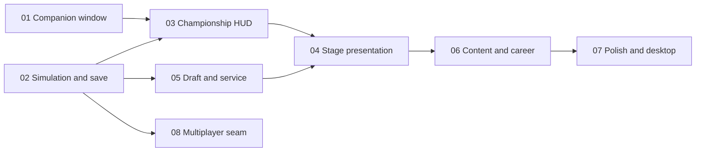

# Roadmap

Read [AGENTS.md](../../AGENTS.md) and [GDD.md](../GDD.md) before phase 1. `AGENTS.md` is the engineering guide (Godot 4.7 practices, folder layout, autoloads, overlay rules). The GDD is the design. These plans say how to build it, in order. Do not start a phase by re-deciding the pillar choices in GDD sections 2, 9, and 13.

`docs/` contains `.gdignore` so the Godot importer skips these files.

## What "MVP" means

Phase 1 is the MVP: a borderless strip docked to the bottom of a screen, always on top, that you can leave running next to a browser or the editor. Clicks outside the strip hit the other app. The strip does not take keyboard focus. It stays cheap while idle.

The MVP does not race, save a championship, or show final art. Those are phases 2 through 7. A strip that already behaves like a companion is the thing we have to prove before the sim is worth building.

## Phases

| Phase | Plan | Depends on | Done when |
| --- | --- | --- | --- |
| 0 | This file, plus [AGENTS.md](../../AGENTS.md) | — | The guide exists and later work follows it. |
| 1 | [01-mvp-docked-window.md](01-mvp-docked-window.md) | Phase 0 | The strip coexists with another app on this Linux machine. |
| 2 | [02-simulation-and-save.md](02-simulation-and-save.md) | Phase 0 | Headless checks cover the solver, the clock, and the save. |
| 3 | [03-championship-hud.md](03-championship-hud.md) | Phases 1 and 2 | A time-scaled championship is readable in the strip. |
| 4 | [04-stage-presentation.md](04-stage-presentation.md) | Phase 3 | The reveal plays the solved timeline. |
| 5 | [05-draft-and-service.md](05-draft-and-service.md) | Phases 2 and 3 | Draft, cards, defaults, and the final table are playable. |
| 6 | [06-content-and-career.md](06-content-and-career.md) | Phases 4 and 5 | The starter catalog is tuned. Career starts only after that. |
| 7 | [07-polish-and-desktop.md](07-polish-and-desktop.md) | Phase 6 | Art, audio, accessibility, export. |
| 8 | [08-multiplayer-later.md](08-multiplayer-later.md) | Phase 2 | A written seam. No network code. |

Phases 1 and 2 can be built in parallel. Phase 3 needs both. Phase 4 needs the HUD's phase host. Phase 5 needs the sim's offers and the HUD's strip. Phase 8 is a constraint on phase 2, not a feature scheduled after polish.

## What waits

- Side dock, screen-share exclude, and OS-level panel reservation: phase 7, and reservation is research only (GDD section 2).
- Illustrated animals, music, and incident stingers: phase 7. Earlier phases use flat `ColorRect` and `Label` placeholders.
- Reputation and unlocks: the second half of phase 6, after one championship is actually pleasant.
- Lobbies, room codes, Steam: not in v1. Phase 8 records the boundary so solo code does not block them.

## How to use a plan

Each later plan has a goal, non-goals, dependencies, tasks, files, and acceptance checks. Implement one phase at a time. When a task lists a `project.godot` key, that edit is in scope; otherwise leave the file to the editor ([AGENTS.md](../../AGENTS.md)).

If a Godot 4.7 platform note disagrees with a plan (especially window flags on Wayland), trust the current [Window](https://docs.godotengine.org/en/4.7/classes/class_window.html) page, record what the machine actually did, and keep the rest of the phase.
